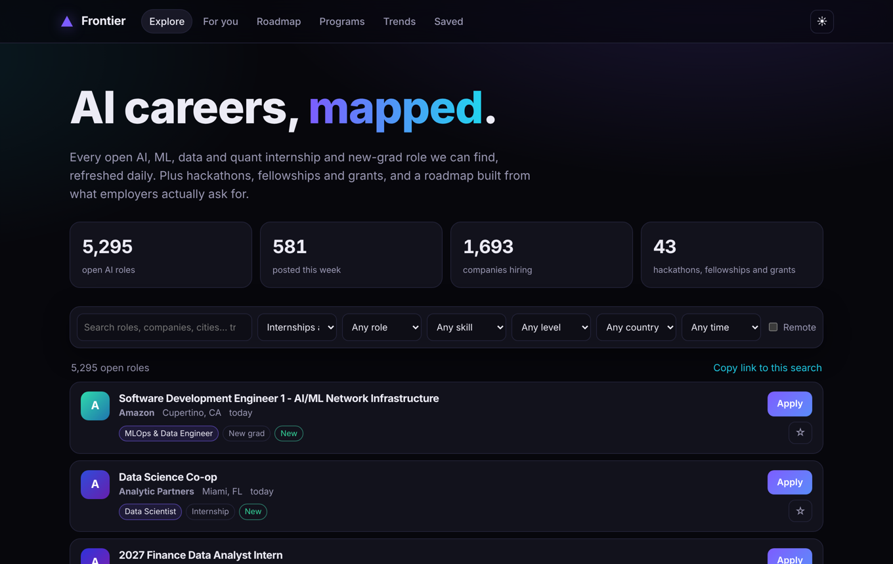
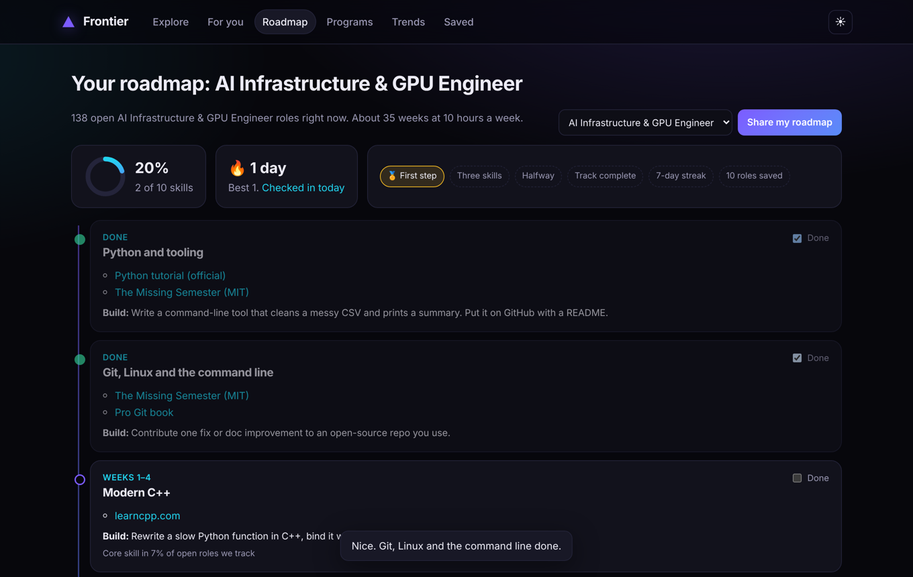
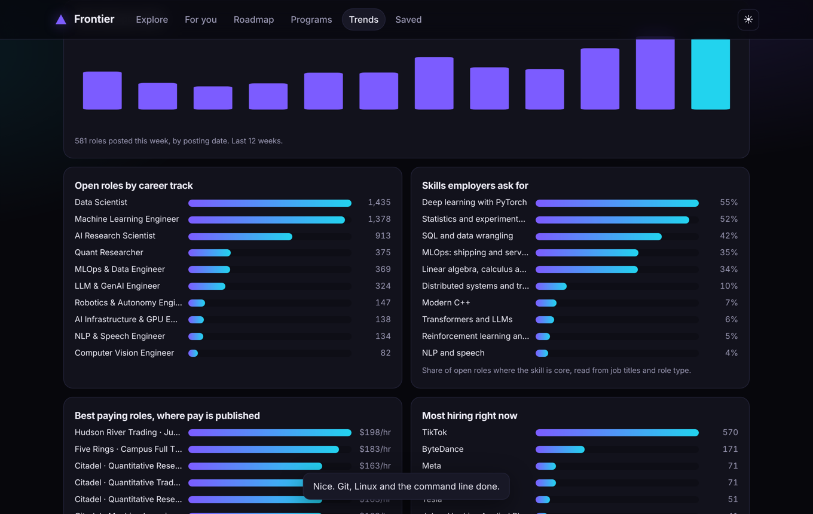

<h1 align="center">▲ Ada</h1>

<p align="center"><b>AI careers, mapped.</b><br>
Every open AI, ML, data and quant internship and new-grad role in one place, refreshed daily.<br>
Plus hackathons, fellowships and grants, a free roadmap built from what employers actually ask for,<br>and an AI coach that writes your personal 90-day plan.</p>

<p align="center">
<b>6,097</b> open roles · <b>1,784</b> companies · <b>409</b> posted this week · <b>100</b> programs · <b>$0</b> to run
</p>

<p align="center"><a href="https://parveen06naresh.github.io/ada/">Open Ada</a> · <a href="docs/paper/ada.pdf">Read the paper (PDF)</a></p>



## Why

AI opportunities are scattered across a dozen GitHub trackers, job boards, university pages and Discord servers. Students check five sites every morning and still miss the role that fit them best. Ada pulls them into one fast, searchable place, tells you which ones fit **you** and why, and gives you a week-by-week plan to close the gap.

## What it does

| | |
|---|---|
| **My matches** | Drop your resume (PDF, Word or text). Ada reads it on your device, ranks every role by fit from 0 to 100, shows the skills you have and lack for each one, lists the skills that open up the most of your target roles, checks your resume the way recruiters and applicant tracking systems do, and gives you an Ada score to raise. Share your result as an image card. Your resume is never uploaded. |
| **Explore** | Search and filter every role by role type, skill, level, country, remote and posting date. Share any search as a link. |
| **For you** | Fill in a 30-second profile, or paste your resume and Ada reads your skills on your device. It ranks roles for you and shows the reason for every match ("Your goal: LLM Engineer · You know 2 of 3 core skills · Posted this week"). |
| **AI coach** | Bring your own Anthropic API key and Claude writes your 90-day plan from your resume, your roadmap and today's best-matching openings: three portfolio projects, the roles to apply to now, and resume fixes. About 10 to 20 cents a plan, paid on your own key. |
| **Roadmap** | Pick one of 10 career tracks. Get a week-by-week plan in prerequisite order, with free courses from Stanford, MIT, fast.ai and Karpathy, a portfolio project for every step, and how much the market asks for each skill. Track progress, keep a streak, earn badges, share your roadmap as a link. |
| **Programs** | 100 hand-picked hackathons, competitions, fellowships, research programs, grants, startup accelerators and free-compute programs. |
| **Trends** | New roles per week, open roles by track, the skills employers ask for, the best-paying roles that publish pay, who is hiring most, and where. |
| **Weekly email** | Sign in and Ada emails you your best new matches every Monday, with the reason each one fits. One-click unsubscribe. There's also an RSS feed of every new role. |
| **Saved** | Star roles and export them to CSV for your application tracker. |
| **Trust** | Every listing links to the employer's own posting and has a "Report" link. A weekly job clicks every program and course link and opens an issue for any that break. |



## Private by design

You never need an account. By default your profile, resume, saved roles and progress stay in your browser. If you use the AI coach, your key and prompt go from your browser straight to Anthropic, never to us. The whole site is static files on GitHub Pages, and a GitHub Action rebuilds the data every morning. Running it costs nothing.

**Optional sync and weekly email.** Sign in with GitHub or an email link to carry your saved roles, profile, resume and roadmap progress across devices. It runs on a free Supabase project with row-level security, so each person can read and write only their own row (`supabase/schema.sql`). Your API key and AI plans are never synced, and "Delete my cloud data" removes your row. Weekly emails go out from a GitHub Action (`.github/workflows/alerts.yml`) that scores roles with the same code as the site and sends through any SMTP service. Forks turn all of this on by filling in `site/config.js` and the repo secrets listed in that workflow; left empty, the sign-in button does not appear.

## Fast on a phone

The role list ships as a columnar file with every repeated string stored once (41% smaller), the newest 40 roles arrive first in a 10 KB file, and a service worker makes repeat visits instant and works offline. On a throttled "slow 4G" phone profile the first roles appear in about 1.7 seconds, down from 11.3.

## Run it locally

```bash
git clone https://github.com/parveen06naresh/ada && cd ada
bash pipeline/fetch.sh .sources              # clone the public trackers (about a minute)
python -m pipeline.build --src .sources      # writes site/data/*.json and feed.xml
python -m http.server -d site 8000           # open http://localhost:8000
```

No dependencies beyond Python 3.10+ for the pipeline and any modern browser for the site.

Tests: `python -m pytest -q tests` and `node --test tests/*.test.mjs`.

## How it works

```
public trackers ──► pipeline/sources.py ──► pipeline/enrich.py ──► pipeline/build.py ──► site/data/*.json ──► site/ (static app)
 (GitHub repos)      read and normalize      keep AI roles, tag       dedupe, stats,         opportunities,       search, matching,
                                             track, skills, level,    RSS feed               programs, skills,    roadmap, trends
                                             country, pay                                    stats
```

* **Sources.** Roles come straight from the public job boards of 67 AI employers (Greenhouse, Lever and Ashby, listed in `pipeline/curated/boards.json`) and from the public trackers by [SimplifyJobs](https://github.com/SimplifyJobs/Summer2027-Internships) ([new grad](https://github.com/SimplifyJobs/New-Grad-Positions)), [speedyapply](https://github.com/speedyapply/2027-AI-College-Jobs) ([SWE](https://github.com/speedyapply/2027-SWE-College-Jobs)) and [vanshb03](https://github.com/vanshb03/Summer2027-Internships) ([new grad](https://github.com/vanshb03/New-Grad-2027)). Ada links straight to each employer's posting. Thank you to their maintainers.
* **Tagging.** Every rule is a readable regex in `pipeline/enrich.py`, so anyone can fix a misfiled role. Skills are read from job titles and role type, because the trackers do not publish full descriptions.
* **Matching.** A transparent points system in `site/js/match.js`. Every point comes with the reason shown on the card. No black box.
* **AI coach.** `site/js/coach.js` sends one request to Claude with the official Anthropic SDK, using the visitor's key. The prompt contains only facts from the page (profile, roadmap, live postings), and the model is told not to invent links or companies.
* **Roadmap.** A skill graph in `pipeline/curated/skills.json`: 19 skills, their prerequisites, free resources and a project each. The planner orders them, skips what you know, and spaces them by your hours per week.



## Contribute

The easiest high-impact contributions:

1. **Add a program**: one JSON object in `pipeline/curated/programs.json` (hackathon, fellowship, grant, research program, accelerator or compute).
2. **Add an employer**: one line in `pipeline/curated/boards.json` (its Greenhouse, Lever or Ashby board), or a new reader in `pipeline/sources.py`.
3. **Improve a roadmap step**: better free resources or projects in `pipeline/curated/skills.json`.
4. **Fix a misfiled role**: adjust a regex in `pipeline/enrich.py` and add a test.

See [CONTRIBUTING.md](CONTRIBUTING.md).

## Honest limits

* Coverage is only as good as the public trackers. They focus on North America and on internships and new-grad roles.
* Pay is published for only a few hundred roles, mostly at large US companies.
* Program dates and amounts change. Always check the official page.

## Contributors

* [Rick](https://github.com/Rick-R100) grew the Programs list from 43 to 100.

## License

MIT. Built by [Parveen Kumar Naresh Kumar](https://www.linkedin.com/in/parveenkumarnareshkumar/) (Applied Math + CS, USF), with AI-assisted development (Claude Code).
